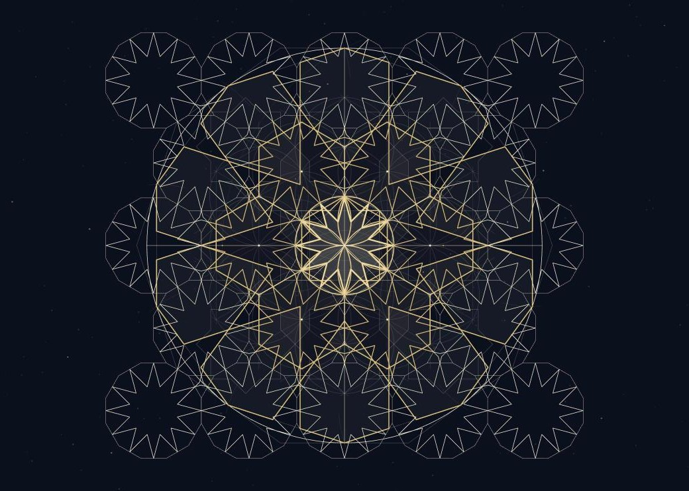
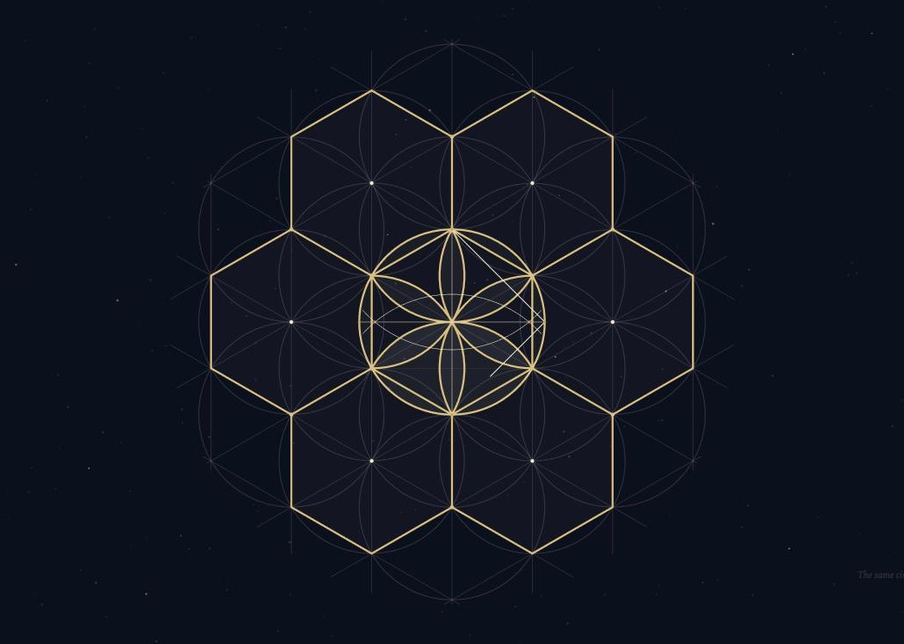
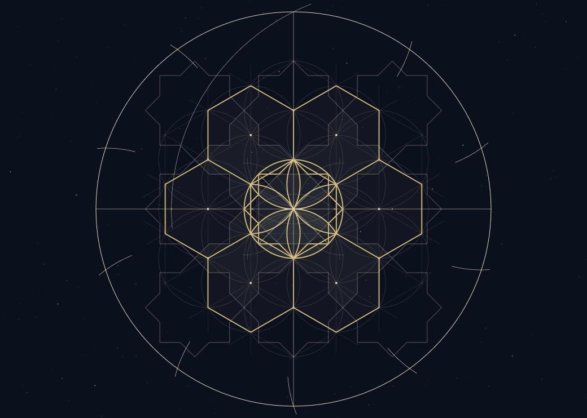

# From the Point

**[Explore the live experience](https://jameel7007.github.io/from-the-point-site/)**

| The sixfold field | Construction toward the next order |
| --- | --- |
|  |  |

A scroll-driven drawing of Islamic geometric patterns. The sequence begins with a point, then develops a circle, vesica, sixfold rose, eightfold *khātam*, tenfold rosette, and twelvefold pattern before returning to the point. The site's colophon credits Keith Critchlow's *Islamic Patterns* as an inspiration.

## How it is drawn

Every figure is constructed live in the browser from one shared radius, using the same compass-and-straightedge relationships a craftsman would use on paper: circles placed on circles, intersections joined, and each new order of pattern grown out of the last. Scroll position drives the whole drawing, so scrolling back unwinds it step by step until only the point remains.

Built with Three.js.

## About this repository

This repository holds the built site that GitHub Pages serves: `index.html`, the bundled JavaScript and CSS in `assets/`, and the README images in `docs/readme/`. The authoring source is kept in a separate repository.

To preview the built files locally, place this repository in a folder named `from-the-point-site/`, run `python3 -m http.server 8000` from the folder above it, and open `http://localhost:8000/from-the-point-site/`. The page expects that path, so opening `index.html` directly will not load its assets.
